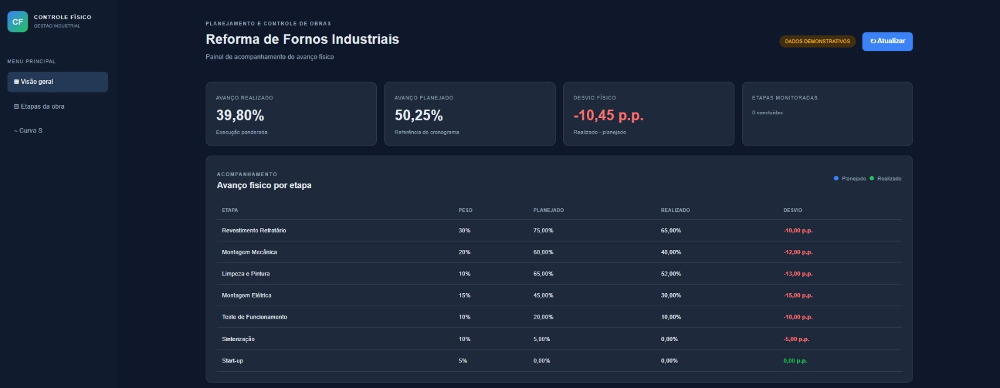
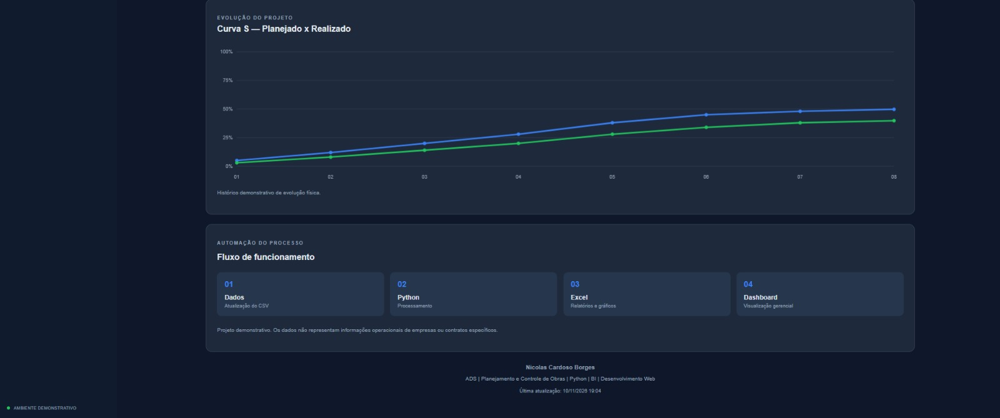
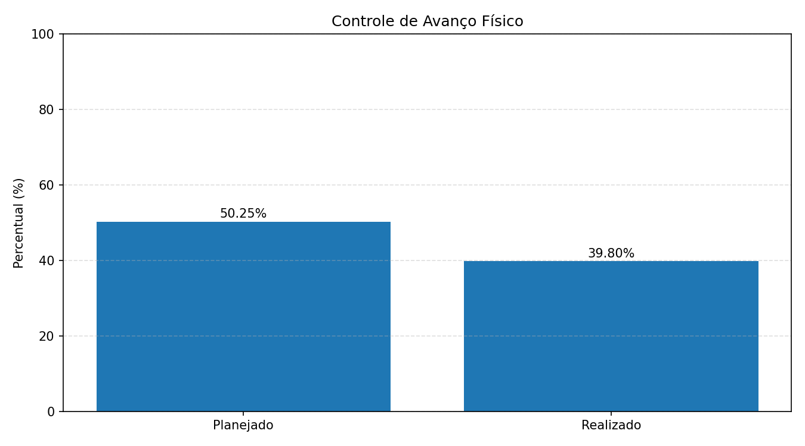

# Controle de Avanço Físico — Reforma de Fornos Industriais

Sistema demonstrativo de **Planejamento e Controle de Obras (PCO)**, desenvolvido com Python, Excel e tecnologias web.

O projeto automatiza o processamento de dados de avanço físico, calcula indicadores de desempenho, gera relatórios em Excel e disponibiliza um dashboard web para acompanhamento do planejamento e da execução das etapas de uma reforma industrial.

> **Projeto de portfólio:** utiliza dados fictícios para fins de demonstração. Não representa uma obra, empresa, contrato ou cronograma real.

---

## Visão geral do dashboard

O painel apresenta indicadores de desempenho, comparação entre avanço planejado e realizado, desvio físico e acompanhamento das etapas.



### Curva S e fluxo de funcionamento

A Curva S permite visualizar a evolução acumulada do avanço planejado em comparação com o realizado.



---

## Funcionalidades

- Leitura automatizada de dados por arquivo CSV.
- Validação dos dados de entrada.
- Cálculo do avanço físico planejado ponderado.
- Cálculo do avanço físico realizado ponderado.
- Cálculo do desvio em pontos percentuais (p.p.).
- Geração automática de planilha Excel.
- Criação de gráfico comparativo em PNG.
- Exportação de dados em JSON.
- Dashboard web responsivo.
- Visualização de indicadores e acompanhamento por etapa.
- Curva S com dados demonstrativos.

## Indicadores do cenário demonstrativo

Na base fictícia incluída nesta versão, os resultados são:

| Indicador | Resultado |
|---|---:|
| Avanço planejado | 50,25% |
| Avanço realizado | 39,80% |
| Desvio físico | -10,45 p.p. |
| Etapas monitoradas | 7 |
| Etapas concluídas | 0 |

Os resultados são calculados automaticamente a partir do arquivo CSV.

---

## Relatórios gerados pelo Python

O programa gera os seguintes arquivos:

### 1. Planilha Excel

Arquivo: `relatorios/controle_avanco.xlsx`

A planilha contém três abas:

- **Resumo:** indicadores gerais do projeto.
- **Etapas:** pesos, percentuais planejados, realizados e desvios.
- **Curva S:** evolução acumulada planejada e realizada.


[Visualizar a planilha em PNG](planilha.png)

### 2. Gráfico de avanço físico

Arquivo: `relatorios/grafico_avanco.png`

Gráfico comparativo entre o percentual planejado e o realizado por etapa.



[Visualizar o gráfico em PNG](relatorios/grafico_avanco.png)

### 3. Dados do dashboard

Arquivo: `dashboard/data.json`

Arquivo JSON produzido pelo Python e consumido pelo JavaScript para atualizar os indicadores, a tabela e a Curva S do painel.

---

## Tecnologias utilizadas

| Tecnologia | Aplicação |
|---|---|
| Python 3 | Processamento e automação |
| CSV | Entrada dos dados |
| JSON | Integração com o dashboard |
| OpenPyXL | Criação e formatação de planilhas Excel |
| Matplotlib | Geração de gráficos |
| HTML5 | Estrutura do dashboard |
| CSS3 | Estilização e responsividade |
| JavaScript | Leitura dos dados e atualização do painel |

---

## Estrutura do projeto

```text
controle-avanco-fornos-industriais/
│
├── dados/
│   └── avanco.csv
│
├── python/
│   └── gerar_relatorios.py
│
├── dashboard/
│   ├── data.json
│   ├── grafico_avanco.png
│   ├── index.html
│   ├── script.js
│   └── style.css
│
├── relatorios/
│   ├── controle_avanco.xlsx
│   └── grafico_avanco.png
│
├── painel-de-controle-1.jpeg
├── painel-de-controle-2.jpeg
├── requirements.txt
├── .gitignore
├── EXECUTAR.bat
└── README.md
```

---

## Como executar no Windows

### 1. Baixar o projeto

Clone o repositório:

```powershell
git clone https://github.com/nicolaszborgesz-coder/controle-avanco-fornos-industriais.git
```

Entre na pasta:

```powershell
cd controle-avanco-fornos-industriais
```

### 2. Criar um ambiente virtual

```powershell
python -m venv .venv
```

Ative o ambiente:

```powershell
.\.venv\Scripts\Activate.ps1
```

### 3. Instalar as dependências

```powershell
python -m pip install -r requirements.txt
```

### 4. Gerar os relatórios

Na pasta principal do projeto, execute:

```powershell
python .\python\gerar_relatorios.py
```

O programa irá processar o CSV e gerar ou atualizar:

- `relatorios/controle_avanco.xlsx`
- `relatorios/grafico_avanco.png`
- `dashboard/data.json`

### 5. Abrir o dashboard

Com o terminal na pasta principal do projeto, execute:

```powershell
python -m http.server 8001 --directory dashboard --bind 127.0.0.1
```

Abra o navegador e acesse:

```text
http://127.0.0.1:8001/
```

Para atualizar o painel após modificar os dados, execute novamente o programa Python e atualize a página.

---

## Como atualizar os dados

Os dados de entrada ficam no arquivo:

`dados/avanco.csv`

Exemplo:

```csv
etapa,peso,planejado,realizado
Revestimento Refratário,30,75,65
Montagem Mecânica,20,60,48
Limpeza e Pintura,10,65,52
Montagem Elétrica,15,45,30
Teste de Funcionamento,10,20,10
Sinterização,10,5,0
Start-up,5,0,0
```

Descrição das colunas:

- **etapa:** nome da atividade.
- **peso:** participação percentual da etapa no avanço total.
- **planejado:** percentual planejado de conclusão da etapa.
- **realizado:** percentual efetivamente executado da etapa.

A soma dos pesos deve ser igual a 100%.

### Cálculo do avanço ponderado

O avanço total é calculado considerando o peso de cada etapa.

Exemplo:

Uma etapa com peso de 30% e execução de 65% contribui com:

`30 × 65 ÷ 100 = 19,5 pontos percentuais`

### Cálculo do desvio físico

O desvio é calculado pela diferença entre o avanço realizado e o planejado:

`Desvio = Realizado - Planejado`

Um resultado negativo indica que a execução está abaixo do planejamento.

---

## Sobre a Curva S

A Curva S desta versão utiliza uma série semanal fictícia, criada para demonstrar a visualização da evolução planejada e realizada.

Ela não representa um histórico real de execução.

Para utilização em um projeto real, seria necessário substituir os valores demonstrativos por registros históricos datados, consistentes e validados.

---

## Objetivo do projeto

Este projeto foi desenvolvido para demonstrar conhecimentos práticos em:

- Automação de processos com Python.
- Manipulação e validação de dados.
- Geração automatizada de relatórios Excel.
- Criação de indicadores de desempenho.
- Planejamento e Controle de Obras (PCO).
- Desenvolvimento de dashboards web.
- Integração entre Python, JSON e JavaScript.
- Organização de projetos e versionamento com Git.

## Autor

**Nicolas Cardoso Borges**

Desenvolvedor Júnior | Python | Automação | HTML | CSS | JavaScript

- GitHub: [@nicolaszborgesz-coder](https://github.com/nicolaszborgesz-coder)

---

## Aviso de confidencialidade

Todos os dados deste repositório são fictícios e foram utilizados exclusivamente para demonstração técnica e composição de portfólio.

Não utilize ou publique informações confidenciais de empresas, contratos, instalações industriais, cronogramas ou operações reais sem autorização.
